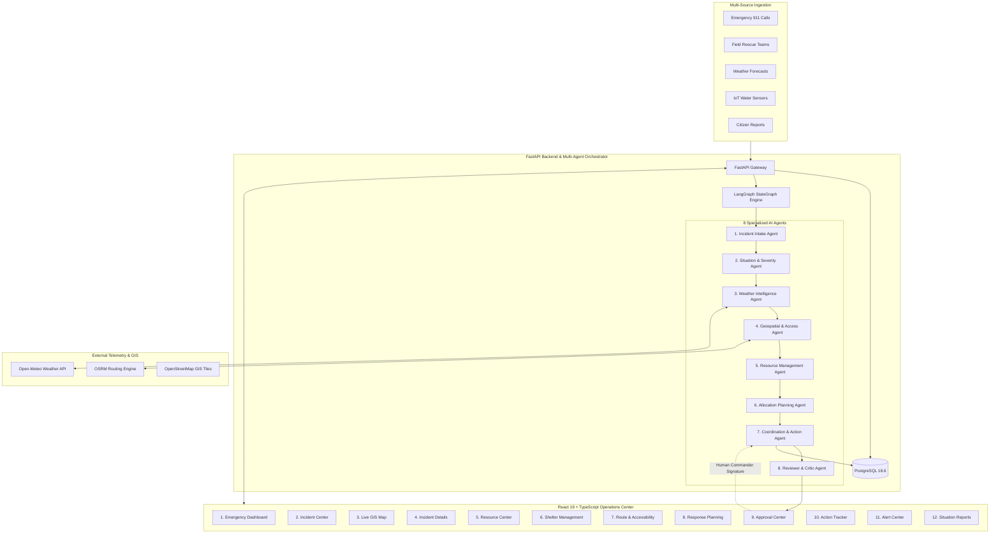

# ResQAI — Agentic AI Disaster Response & Emergency Resource Coordination System

> **Decision-Support Emergency Operations Platform** powered by Multi-Agent AI Orchestration, GIS Road Intelligence, Real-Time Environmental Telemetry, and Human-in-the-Loop Governance.

[](https://www.python.org/)
[](https://fastapi.tiangolo.com/)
[](https://react.dev/)
[](https://www.typescriptlang.org/)
[](https://www.postgresql.org/)
[](https://langchain-ai.github.io/langgraph/)
[](LICENSE)

---

## 1. Project Overview & Problem Statement

Natural and human-caused disasters—such as severe flash floods, cyclones, earthquakes, wildfires, and urban emergencies—generate overwhelming volumes of rapidly fluctuating telemetry across 911 calls, field responder reports, meteorological models, IoT flood sensors, and GIS road authorities.

Emergency coordinators face critical bottlenecks:
* What incidents are occurring and where are the high-risk clusters?
* Which access corridors are severed or inundated?
* Which response assets (boats, ambulances, rescue squads) are currently deployed vs. available?
* Which shelters are approaching saturation?
* How should assets be distributed without double-allocating or hallucinating fictitious resources?
* How does the system adapt dynamically when a key access road abruptly closes?

**ResQAI** solves this through a coordinated network of **eight specialized AI agents** orchestrated via **LangGraph**. The system normalizes multi-source incident reports, calculates transparent deterministic priority scores, analyzes real-time weather hazards, evaluates road accessibility, dynamically replans allocations upon road blockages, and presents recommendations to authorized human commanders with zero autonomous dispatch.

---

## 2. System Architecture



---

## 3. Multi-Agent Architecture & Responsibilities

ResQAI implements eight specialized agents connected through a shared workflow state:

| # | Specialized Agent | Primary Responsibility | Input Artifacts | Deterministic Output |
|---|---|---|---|---|
| **1** | **Emergency Incident Intake** | Ingest unstructured and structured reports, validate completeness, extract metadata, and identify duplicates. | Call text, source, location, urgency | Normalized incident schema, duplicate flags |
| **2** | **Situation Assessment & Severity** | Calculate transparent, deterministic response priority based on population, urgency, and infrastructure impact. | People affected, urgency, road status | Priority Score (0–100), Level (`Critical`, `High`, `Moderate`, `Low`) |
| **3** | **Weather & Environmental Intelligence** | Retrieve telemetry from Open-Meteo, assess severe rainfall/wind hazards, and trigger incident reassessment. | Coordinates, timestamp | Weather summary, storm warnings, reassessment flag |
| **4** | **Geospatial & Accessibility** | Geocode locations, distinguish Known Road Closures from AI-inferred access problems, query OSRM route candidates. | Road registry, coordinates | Accessibility classification, route candidates with disclaimer |
| **5** | **Emergency Resource Management** | Track resource lifecycle (`Available` ➔ `Reserved` ➔ `Deployed` ➔ `Returning`) and compute exact fleet deficits. | Resource table, quota | Resource availability, deficit count, row-level locks |
| **6** | **Resource Allocation & Response Planning** | Match capabilities to incident requirements under transit constraints without hallucinating uninvented resources. | Prioritized incidents, available fleet | Feasible assignments, mutual aid escalation plans |
| **7** | **Emergency Coordination & Action** | Synthesize all agent artifacts into a comprehensive Incident Action Plan awaiting human authorization. | Agent 1–6 artifacts | Step-by-step action plan, approval requests |
| **8** | **Reviewer & Critic Audit** | Validate safety constraints: ensure automatic dispatch is disabled, check for duplicate assignments, and audit road safety warnings. | Proposed action plan, critic rules | Audit status (`Ready for Human Review` vs `Needs Revision`) |

### Shared Workflow State Schema (LangGraph)
```python
class DisasterWorkflowState(TypedDict, total=False):
    incident: dict               # Initial incident report
    weather: Optional[dict]      # Weather observations / forecast
    latitude: float              # Geospatial coordinates
    longitude: float
    resources: list[dict]        # Available fleet registry
    required_resource_type: str  # Requested asset category
    quantity: int                # Desired quantity
    road_accessible: Optional[bool]

    # Progressive Agent Outputs
    intake: dict                 # Agent 1
    situation: dict              # Agent 2
    weather_assessment: dict     # Agent 3
    geospatial: dict             # Agent 4
    resource_assessment: dict    # Agent 5
    resource_plan: dict          # Agent 6
    action_plan: dict            # Agent 7
    review: dict                 # Agent 8
```

---

## 4. Methodologies & Algorithmic Design

### A. Deterministic Priority Assessment Methodology
To eliminate LLM score hallucination, numerical priority scores are computed via a documented, transparent deterministic model:
$$\text{Score} = \min\left(100, \text{PopPts} + \text{UrgencyPts} + \text{AccessPts} + \text{WeatherPts} + \text{InfraPts}\right)$$
* **Affected Population Factor:** $\min(40, \lfloor \text{PeopleAffected} / 2.5 \rfloor)$
* **Urgency Rating Factor:** $\text{Urgency} \times 8$ (up to 40 pts)
* **Access Route Inaccessibility:** $+15$ pts if Road is Closed / Cut off; $+8$ pts if Partially Blocked; $+5$ pts if Unverified.
* **Severe Weather Penalty:** $+10$ pts if active precipitation $\ge 10\text{mm}$ or winds $\ge 40\text{km/h}$.
* **Critical Infrastructure Damage:** $+10$ pts if embankments, bridges, or housing flooded.

**Priority Levels:**
* **Critical:** $\ge 75$
* **High:** $50 - 74$
* **Moderate:** $25 - 49$
* **Low:** $< 25$

### B. Duplicate Detection Methodology
When multiple citizens or agencies report the same incident:
1. Compares disaster type (e.g. `Flood`), geographic zone/location (fuzzy and substring matching), and description keywords.
2. If similarity criteria match, sets `possible_duplicate = 1` and links `duplicate_of = primary_incident_id`.
3. **Preserves all reports without deletion:** Flags the record for human commander review.

### C. Road Classification: Known Closure vs. AI Inference
The system strictly distinguishes:
* **Known Road Closure:** Ground-truth official report from traffic/emergency authorities (e.g., Road submerged by canal breach).
* **AI-Inferred Potential Accessibility Problem:** Probabilistic warning generated due to incident proximity to active floodwaters.
The two are never conflated as equivalent operational facts.

### D. Dynamic Replanning Engine (TC-05)
When road conditions deteriorate (e.g., Road to Zone A changes from Open to Closed):
1. Detects destination zone of closed corridor.
2. Queries database for active allocations and incidents reliant on that route.
3. Automatically transitions incident status to `Needs Reassessment`.
4. Alerts the coordinator via the Real-Time Alert Center (`ROUTE_BLOCKED`).
5. Recomputes feasible plans: evaluates high-clearance staging, rescue boats, or mutual-aid air extraction.

### E. Concurrency & Double Allocation Prevention (TC-08)
When allocating resources, PostgreSQL row-level locks (`SELECT * FROM resources WHERE resource_id = ? FOR UPDATE`) serialize concurrent requests inside an atomic transaction. If two coordinators or automated workers attempt to allocate `BOAT-001` simultaneously, the first receives `HTTP 201 Created` while the second is rejected with `HTTP 409 Conflict`.

---

## 5. Twelve Operational Frontend Pages

The React 19 + TypeScript frontend (`frontend-app`) provides twelve specialized modules:

1. **Emergency Dashboard:** Comprehensive situational snapshot with real-time incident counters, resource availability, shelter capacity, and urgent watchlist.
2. **Incident Center:** Multi-source intake form (Citizen, 911, Field Team, IoT, Gov Alert), duplicate detector, and incident register.
3. **Live GIS Map:** Full interactive Leaflet map featuring custom-styled pins for incidents (color-coded by priority), available/deployed resources, shelters, and road closures.
4. **Incident Details:** Deep-dive inspector displaying exact score breakdowns, intake validation, weather telemetry, and recommended actions.
5. **Resource Center:** Complete inventory management with capability tags and interactive status transition controls (`Available` ➔ `Reserved` ➔ `Deployed` ➔ `Returning`).
6. **Shelter Management:** Real-time capacity progress bars, occupancy updater, and saturation alerts (`>= 90% Near Full`, `100% Full`).
7. **Route & Accessibility:** Road network status list, Known Closure vs. AI Inference tags, interactive road status toggles, and TC-05 dynamic replanning triggers.
8. **Response Planning:** Interactive LangGraph 8-Agent workflow runner and resource shortage calculator.
9. **Approval Center:** Human-in-the-loop authorization queue allowing commanders to Approve (deploys resource), Reject (releases resource), or Modify recommendations with signed comments.
10. **Action Tracker:** Lifecycle tracking of tactical tasks (`Open` ➔ `In Progress` ➔ `Completed`), resource assignments, and timestamped remarks.
11. **Alert Center:** Central notification hub logging Critical, Warning, and Info alerts with one-click acknowledgement.
12. **Situation Reports & Tools:** ReportLab PDF situation report download button, worsening weather simulation tool (TC-07), and baseline scenario reset button.

---

## 6. Acceptance Testing Scenarios (TC-01 through TC-08)

All eight required test cases are automated in `test_all_scenarios.py`:

| Test ID | Scenario | Expected Behavior | Result |
|---|---|---|---|
| **TC-01** | New flood incident reported | Incident registered, intake validated, priority deterministically scored (Score: 63, Level: High). | **PASS** |
| **TC-02** | Same incident reported by two sources | Second report detected as duplicate of primary incident, linked without deletion, alert logged. | **PASS** |
| **TC-03** | Critical incident with available resources | LangGraph 8-agent workflow produces feasible boat allocation; Reviewer marks `Ready for Human Review`. | **PASS** |
| **TC-04** | Required resources exceed availability | Shortage detector calculates exact deficit (Req: 8, Avail: 5, Deficit: 3); suggests escalation without hallucinating. | **PASS** |
| **TC-05** | Assigned road becomes blocked | Dynamic replanning triggered; affected deployments identified; status changed to `Needs Reassessment`. | **PASS** |
| **TC-06** | Shelter approaches full capacity | Occupancy at 92.5% triggers `NEAR_FULL` alert; 100% triggers `FULL` saturation alert. | **PASS** |
| **TC-07** | Weather forecast worsens | Simulated severe storm (22.5mm rain, 55km/h wind) updates incident to `Needs Reassessment`. | **PASS** |
| **TC-08** | Double allocation prevention | Serialized row locks grant Request 1 `HTTP 201` and reject Request 2 with `HTTP 409 Conflict`. | **PASS** |

To execute the complete test suite:
```bash
python test_all_scenarios.py
```

---

## 7. Local Setup & Execution Guide

### Prerequisites
* Python 3.12+
* Node.js 20+ and npm
* PostgreSQL 14+ (or SQLite fallback)

### Step 1: Clone Repository & Virtual Environment
```bash
git clone <repository-url>
cd agentic-disaster-response

# Create and activate Python virtual environment
python -m venv .venv
# Windows PowerShell:
.\.venv\Scripts\Activate.ps1
# Linux/macOS:
source .venv/bin/activate

# Install backend dependencies
pip install -r requirements.txt
```

### Step 2: Configure Environment Variables
Create a `.env` file in the project root:
```env
DB_HOST=127.0.0.1
DB_PORT=5432
DB_NAME=disaster_response
DB_USER=postgres
DB_PASSWORD=your_postgres_password

# Optional: To use SQLite instead of PostgreSQL:
# USE_SQLITE=true
```

### Step 3: Run Backend
```bash
python -m uvicorn backend.main:app --host 127.0.0.1 --port 8000 --reload
```
* **API Documentation (Swagger UI):** `http://127.0.0.1:8000/docs`
* **Health Check:** `http://127.0.0.1:8000/health`
* **PDF Report Download:** `http://127.0.0.1:8000/reports/situation`

### Step 4: Run Frontend Operations Center
In a second terminal:
```bash
cd frontend-app
npm install
npm run dev
```
Open your browser at `http://localhost:5173`.

### Step 5: Production Build Verification
To test frontend production bundling:
```bash
cd frontend-app
npm run build
```

---

## 8. Deployment Architecture

* **Backend Deployment (Render / Railway / AWS):**
  * Runtime: Python 3.12
  * Start Command: `uvicorn backend.main:app --host 0.0.0.0 --port $PORT`
  * Database: Managed PostgreSQL (Set `DATABASE_URL` environment variable).
* **Frontend Deployment (Vercel / Netlify):**
  * Root Directory: `frontend-app`
  * Build Command: `npm run build`
  * Output Directory: `dist`
  * Environment Variable: `VITE_API_URL=<deployed-backend-url>`

---

## 9. Safety & Governance Statement

> **Academic / Prototype Decision-Support Disclaimer:**
> ResQAI is an academic decision-support platform designed to assist emergency commanders. It is **not** authorized to autonomously dispatch physical emergency personnel, override public-safety officials, or issue unilateral evacuation orders. All critical deployment decisions enforce mandatory human commander authorization (`automatic_dispatch: false`). When data is uncertain or unverified, the system explicitly states **"Verification Required"** rather than inventing facts.
