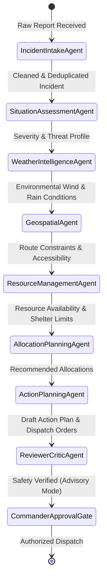

# ResQAI — Multi-Agent Workflow & Message Handoff Specification

This document details the LangGraph StateGraph architecture, inter-agent message passing schemas, and state transitions across all 8 specialized agents and the Reviewer/Critic safety auditor.

---

## 1. LangGraph StateGraph Architecture

The ResQAI multi-agent pipeline is orchestrated via a deterministic StateGraph where each agent receives an immutable snapshot of the workflow state, executes domain reasoning, calls specialized tools, and produces a structured output dictionary merged into the global state.



---

## 2. Shared State Schema (`ResQWorkflowState`)

```python
class ResQWorkflowState(TypedDict):
    incident_raw: dict[str, Any]
    intake_result: dict[str, Any]
    severity_assessment: dict[str, Any]
    weather_assessment: dict[str, Any]
    geospatial_assessment: dict[str, Any]
    resource_assessment: dict[str, Any]
    allocation_plan: dict[str, Any]
    action_plan: dict[str, Any]
    critic_review: dict[str, Any]
    execution_mode: str  # "Advisory" | "HITL_Gate"
    human_approval_required: bool
    autonomous_dispatch_blocked: bool
```

---

## 3. Detailed Agent Specifications

### Agent 1: Emergency Incident Intake Agent
- **Responsibility**: Ingestion, normalization, spatial entity extraction, and duplicate detection.
- **Inputs**: Raw emergency call, field report, or citizen text, latitude, longitude, reported urgency.
- **Reasoning**:
  - Computes spatial distance via Haversine formula against active incident registry.
  - Computes textual token similarity using Cosine similarity.
  - Flags duplicate if `distance <= 2.0 km` and `similarity >= 0.72`.
- **Handoff Message**: `[Agent 1 -> Agent 2]` Validated incident record with normalized location and deduplication status.

### Agent 2: Situation Assessment & Severity Agent
- **Responsibility**: Severity scoring ($0-100$) and priority categorization (Critical, High, Medium, Low).
- **Formula**:
  $$\text{Score} = \min(100, (\text{Urgency} \times 12) + (\text{People Affected} \times 0.6) + \text{Vulnerability Factor})$$
- **Handoff Message**: `[Agent 2 -> Agent 3]` Calculated severity score, priority category, and escalation indicators.

### Agent 3: Weather Telemetry Intelligence Agent
- **Responsibility**: Live meteorological telemetry evaluation (Open-Meteo REST API).
- **Triggers**:
  - Precipitation $\ge 25\text{ mm/h}$ or Wind $\ge 50\text{ km/h}$ triggers severe storm alert.
  - Automatically flags connected incidents as `Needs Reassessment`.
- **Handoff Message**: `[Agent 3 -> Agent 4]` Wind vector, precipitation intensity, and storm trend forecast.

### Agent 4: Geospatial & Road Accessibility Agent
- **Responsibility**: Route planning, impassable road avoidance, and evacuation corridor safety.
- **Reasoning**:
  - Checks road status registry (`Open`, `Partially Blocked`, `Closed`).
  - When road status updates to `Closed`, recalculates ETA and prompts dynamic replanning.
- **Handoff Message**: `[Agent 4 -> Agent 5]` Route accessibility status and alternative travel corridors.

### Agent 5: Emergency Resource & Shelter Management Agent
- **Responsibility**: Resource inventory queries, shortage calculations, and shelter saturation tracking.
- **Rules**:
  - Shelter occupancy $\ge 85\%$ triggers `NEAR_FULL` alert.
  - Shelter occupancy $= 100\%$ triggers `FULL` alert and auto-diversion recommendations.
  - Evaluates equipment deficits (e.g. required 8 boats vs available 5 = deficit of 3).
- **Handoff Message**: `[Agent 5 -> Agent 6]` Available resource IDs, deficit counts, and eligible destination shelters.

### Agent 6: Resource Allocation Planning Agent
- **Responsibility**: Optimal resource-to-incident pairing.
- **Reasoning**:
  - Assigns nearest available units matching required capability.
  - Prepares reservation records subject to atomic locks.
- **Handoff Message**: `[Agent 6 -> Agent 7]` Candidate allocation pairs with calculated transit times.

### Agent 7: Action & Coordination Planning Agent
- **Responsibility**: Time-sequenced emergency response plan.
- **Output**:
  - Evacuation route instructions.
  - Staging area coordinates.
  - Multi-agency coordination broadcast drafts.
- **Handoff Message**: `[Agent 7 -> Agent 8]` Complete unified response action plan for critical safety audit.

### Agent 8: Reviewer & Critic Safety Auditor
- **Responsibility**: Independent constitutional compliance verification.
- **Verifications**:
  1. **Zero Autonomous Dispatch**: Strictly sets `autonomous_dispatch = False` and `human_approval_required = True`.
  2. **Double Allocation Check**: Confirms no resource is assigned to multiple active missions.
  3. **Capacity Check**: Confirms chosen evacuation shelter has non-zero available capacity.
  4. **Route Viability**: Confirms assigned path does not traverse `Closed` segments.
- **Output**: Issues `Safety Certification: Validated for Commander Review`.

---

## 4. Message Handoff Architecture & UI Visualization

In the ResQAI Command Center UI, every agent transition renders an interactive **Message Handoff Banner**:
- **Incoming Message Box**: Shows exact payload received from preceding agent.
- **Agent Reasoning Box**: Displays deterministic formulas and rule logic.
- **Outgoing Message Box**: Displays structured payload handed off to the downstream agent.
- **Plain English Card**: Translates technical agent outputs into clear plain-English briefings for non-technical emergency managers.
