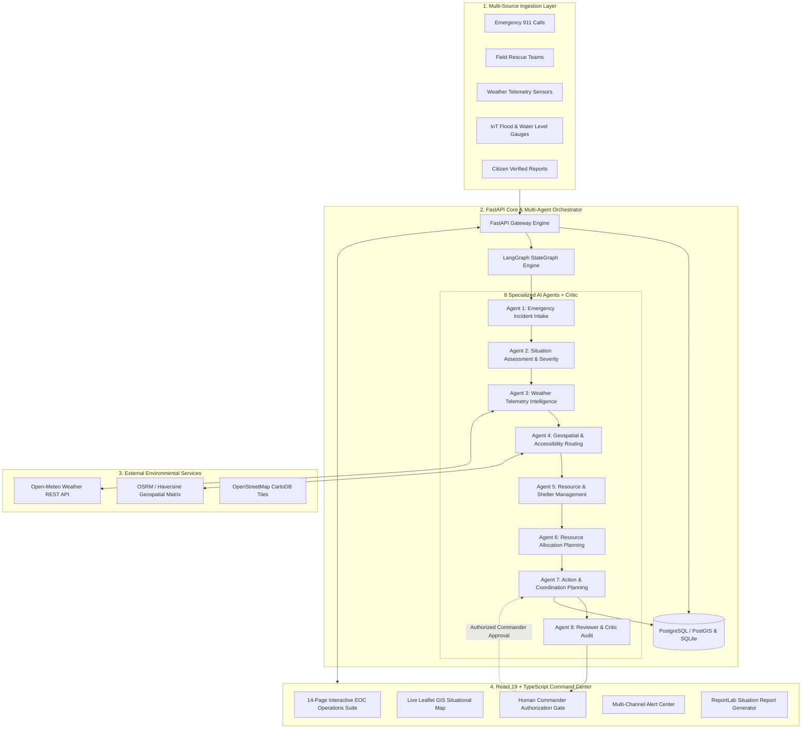

# ResQAI — System Architecture & Multi-Agent Design

ResQAI is an **Agentic AI Disaster Response & Emergency Resource Coordination System** engineered for crisis scenarios such as floods, cyclones, earthquakes, and major industrial emergencies. It combines real-time multi-source data ingestion, deterministic priority scoring, geospatial road intelligence, dynamic replanning, and human-in-the-loop authorization.

---

## 1. High-Level System Architecture

---

## 2. Multi-Agent Orchestration Engine

The multi-agent system is built using **LangGraph** (StateGraph) with explicit TypedDict state propagation and Pydantic v2 schemas:

1. **Incident Intake Agent (`Agent 1`)**: Normalizes disparate incoming reports, cleans text, extracts geographical entities, and computes Cosine similarity + Haversine distance to detect duplicate incident reports within 2.0 km and 0.72 similarity threshold.
2. **Situation Assessment & Severity Agent (`Agent 2`)**: Calculates deterministic severity scores ($0-100$) and categorizes urgency (Critical, High, Medium, Low) using transparent mathematical scoring formulas:
   $$\text{Score} = \min(100, (\text{Urgency} \times 12) + (\text{People Affected} \times 0.6) + \text{Vulnerability Factor})$$
3. **Weather Intelligence Agent (`Agent 3`)**: Integrates real-time Open-Meteo REST API feeds, evaluates precipitation, wind speeds, and tropical storm trajectories, flagging high-risk adverse conditions.
4. **Geospatial & Road Accessibility Agent (`Agent 4`)**: Computes Haversine distances to nearest staging centers, evaluates road network obstructions, and tags flooded route segments.
5. **Resource Management Agent (`Agent 5`)**: Tracks live resource inventory (rescue boats, ambulances, fire engines, heavy excavation pumps, medical triage teams), monitors shelter saturation (alerting at 85% and 100%), and flags equipment shortages with mutual-aid recommendations.
6. **Allocation Planning Agent (`Agent 6`)**: Generates optimized resource allocation plans matching incident requirements against available unallocated equipment.
7. **Action Planning & Coordination Agent (`Agent 7`)**: Formulates concrete, time-sequenced emergency response actions (dispatch orders, evacuation corridors, shelter diversions).
8. **Reviewer & Critic Safety Auditor (`Agent 8`)**: Performs sanity checks on the aggregated plan:
   - Verifies **no double allocation** has occurred.
   - Enforces **zero autonomous physical dispatch** — flags all operational orders for human authorization.
   - Verifies shelter capacity limits are respected.

---

## 3. Human-in-the-Loop (HITL) Safety Gate

ResQAI enforces a strict constitutional rule: **AI recommends, humans authorize**.
- No real-world rescue asset, medical unit, or evacuation transport can be dispatched autonomously by AI.
- The Approval Gate displays pending AI action plans with full provenance, explanation, and risk factors.
- Authorized commanders can **Approve**, **Reject**, or **Modify** proposed actions before any physical deployment status transition occurs.

---

## 4. Concurrency & Double-Allocation Prevention

Resource allocations utilize atomic transactions with serialized concurrency locks:
- When a resource is selected for reservation or dispatch, an atomic database lock verifies `status == 'Available'`.
- If two incident requests target the same resource simultaneously, the second transaction is rejected with **HTTP 409 Conflict**.
- Verified through automated concurrency testing (`test_concurrency.py`).

---

## 5. Technology Stack Summary

| Layer | Technologies |
|---|---|
| **Frontend** | React 19, TypeScript, Vite, Vanilla CSS Design System, Leaflet GIS, Lucide Icons |
| **Backend** | Python 3.12, FastAPI, Pydantic v2, Uvicorn, LangGraph, ReportLab PDF |
| **Database** | PostgreSQL 15 + PostGIS (Production) / SQLite (Local Demo) |
| **Integrations** | Open-Meteo Weather API, OpenStreetMap GIS CartoDB, Twilio/Gov Simulation Gateway |
| **Testing** | Pytest, FastAPI TestClient, Vitest/TSC |
