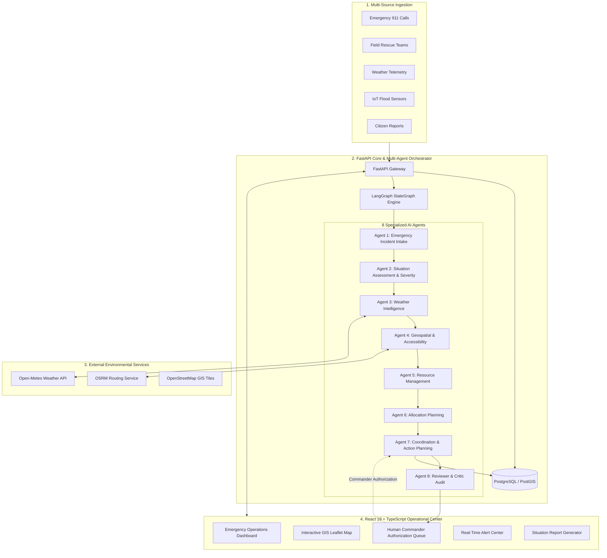
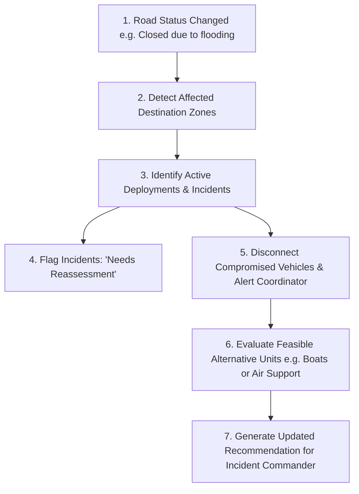

# ResQAI — System Architecture & Multi-Agent Design

ResQAI is an **Agentic AI Disaster Response & Emergency Resource Coordination System** engineered for crisis scenarios such as floods, cyclones, earthquakes, and major industrial emergencies. It combines real-time data ingestion, deterministic priority scoring, geospatial road intelligence, dynamic replanning, and human-in-the-loop authorization.

---

## 1. High-Level System Architecture



---

## 2. Multi-Agent Orchestration Flow (LangGraph)

The system coordinates eight specialized AI agents via a sequential **LangGraph StateGraph** with immutable state tracking and explainable intermediate reasoning:

```mermaid
sequenceDiagram
    autonumber
    actor Caller as Emergency Source
    participant Intake as Agent 1: Intake
    participant Situation as Agent 2: Severity
    participant Weather as Agent 3: Weather
    participant Geo as Agent 4: Geospatial
    participant Res as Agent 5: Resources
    participant Plan as Agent 6: Allocation
    participant Coord as Agent 7: Coordination
    participant Critic as Agent 8: Critic
    actor Commander as Authorized Human Commander

    Caller->>Intake: Emergency Incident Report (text/telemetry)
    Intake->>Intake: Extract disaster, zone, people affected, duplicate check
    Intake->>Situation: Structured incident & baseline score
    Situation->>Situation: Deterministic multi-factor priority scoring
    Situation->>Weather: Incident coordinates & location
    Weather->>Weather: Check rainfall, wind speed, severe storm codes
    Weather->>Geo: Environmental hazard assessment
    Geo->>Geo: Classify route accessibility (Known Closure vs Inferred)
    Geo->>Res: Destination zone & required resource types
    Res->>Res: Check fleet availability; identify shortages
    Res->>Plan: Fleet inventory & constraint map
    Plan->>Plan: Match capabilities, distance, allocate available units
    Plan->>Coord: Recommended resource assignments
    Coord->>Coord: Draft tactical action plan (automatic dispatch disabled)
    Coord->>Critic: Complete response proposal
    Critic->>Critic: Audit safety bounds, verify no double allocation
    Critic-->>Commander: Plan flagged 'Ready for Human Review'
    Commander->>Coord: Approve / Reject / Modify
    Coord->>Res: Transition resource status (Reserved -> Deployed)
```

---

## 3. Specialized Agent Responsibilities

| Agent | Name | Primary Responsibility | Input Data | Key Output |
|---|---|---|---|---|
| **Agent 1** | **Emergency Incident Intake** | Normalize unstructured reports, extract disaster type, people affected, urgency, and detect duplicates. | Call text, source, location, urgency | Normalized incident schema, duplicate flags |
| **Agent 2** | **Situation Assessment & Severity** | Calculate transparent, deterministic priority scores without LLM hallucinations. | Intake data, population impact | Priority score (0-100), Priority level (Critical, High, Moderate, Low), contributing factors |
| **Agent 3** | **Weather & Environmental Intelligence** | Retrieve telemetry from Open-Meteo and evaluate severe rainfall/wind operational hazards. | Coordinates, timestamp | Weather summary, severe storm warning, reassessment flags |
| **Agent 4** | **Geospatial & Accessibility** | Geocode locations, distinguish Known Road Closures from AI-inferred access concerns, evaluate OSRM routes. | Road status registry, coordinates | Accessibility classification, candidate routes, road safety warnings |
| **Agent 5** | **Emergency Resource Management** | Maintain resource inventory lifecycle (Available ➔ Reserved ➔ Deployed ➔ Returning) and detect shortages. | Resource registry, requested quota | Fleet status, deficit counts, double allocation locks |
| **Agent 6** | **Resource Allocation & Response Planning** | Match resource capabilities to incident demands under distance/access constraints. | Prioritized incidents, available fleet | Feasible recommendations, mutual-aid alternative escalations |
| **Agent 7** | **Emergency Coordination & Action** | Synthesize all assessments into a cohesive incident action plan requiring commander approval. | Outputs from Agents 1–6 | Step-by-step action plan, approval requests |
| **Agent 8** | **Reviewer & Critic Audit** | Validate that safety boundaries are respected, automatic dispatch is disabled, and no contradictions exist. | Draft action plan, critic rules | Audit status (`Ready for Human Review` vs `Needs Revision`) |

---

## 4. Shared Workflow State Schema

The LangGraph engine maintains a structured TypedDict state passed sequentially across all nodes:

```python
class DisasterWorkflowState(TypedDict, total=False):
    # Initial Ingestion Inputs
    incident: dict
    weather: Optional[dict]
    latitude: float
    longitude: float
    resources: list[dict]
    required_resource_type: str
    quantity: int
    road_accessible: Optional[bool]

    # Progressive Agent Artifacts
    intake: dict                  # Agent 1 output
    situation: dict               # Agent 2 output
    weather_assessment: dict      # Agent 3 output
    geospatial: dict              # Agent 4 output
    resource_assessment: dict     # Agent 5 output
    resource_plan: dict           # Agent 6 output
    action_plan: dict             # Agent 7 output
    review: dict                  # Agent 8 audit report
```

---

## 5. Dynamic Replanning Architecture (TC-05)

When a road closure occurs during an ongoing emergency, the dynamic replanning engine reacts deterministically:



---

## 6. Database Schema Design (PostgreSQL)

The database schema enforces data integrity with strict foreign keys, check constraints, and concurrency row locking:

* `incidents`: Unique ID, disaster type, description, location, affected population, urgency, source, deterministic severity score, verification status, duplicate links, and geospatial coordinates.
* `resources`: Resource ID, type, name, location, capacity, capability, status lifecycle, and coordinates.
* `shelters`: Shelter ID, name, location, total capacity, occupied count, and operational status.
* `allocations`: Atomic mapping between incidents and resources with transaction-level concurrency control (`FOR UPDATE`).
* `roads`: Road ID, origin/destination, status (`Open`, `Partially Blocked`, `Closed`), and classification (`Known Road Closure` vs `AI-Inferred`).
* `approval_requests`: Authorization queue requiring reviewer name, decision (`Approved`, `Rejected`, `Modified`), and commander comments.
* `response_actions`: Tactical actions tracked through lifecycle `Open` ➔ `In Progress` ➔ `Completed`.
* `alerts`: System notification log with severity levels (`Critical`, `Warning`, `Info`) and acknowledgement state.
